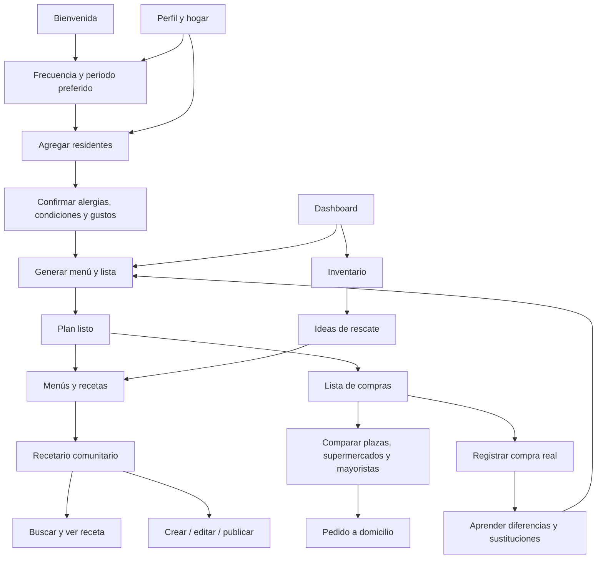

# Despensa Viva — guía de prototipo UX/UI

Prototipo de alta fidelidad responsive para validar la experiencia de planeación de alimentos de un hogar colombiano. El archivo `despensa-viva.html` es navegable: el menú lateral/inferior, los CTA, chips, búsqueda y cambio de tema permiten recorrer los flujos. Los datos y precios son ficticios y sirven para discusión, no son cotizaciones de comercios.

## Concepto e identidad

**Nombres candidatos:** Despensa Viva (recomendado), A Mano, Buen Mercado, Raíz y Mesa, Cosecha en Casa.

**Promesa:** comprar lo necesario para comer rico, cuidar las necesidades del hogar y aprovechar lo que ya se tiene.

**Paleta:** verde bosque `#234C3C` para acciones y marca; verde hoja `#557B54` para frescura; salvia `#E6EEE3` para selección y superficies; crema `#F7F5EF` y blanco cálido `#FFFEFA` para fondos; tierra `#D87538` para acciones de rescate; amarillo `#EDB94F` para avisos de vencimiento; rojo `#B95243` solo para riesgo/error. No depender solo del color: estado siempre acompañado de texto e icono.

**Tipografía:** Inter para interfaz; sistema sans-serif como fallback. Jerarquía con títulos de 25–30 px, texto de lectura de 13–16 px y metadatos nunca menores de 11 px. **Iconografía:** símbolos simples estilo Lucide/Material, siempre junto a etiquetas en navegación y controles esenciales. **Accesibilidad:** contraste AA como objetivo, áreas táctiles de 44 px, foco visible, etiquetas de formularios, estados con texto y soporte de tema claro/oscuro y texto ampliable. Revalidar contraste con tokens finales en Figma.

## Hogar de referencia

- **Mariana Ramírez**, 36, mujer; diabetes tipo 2; prefiere comida casera y porción moderada.
- **Andrés Ramírez**, 39, hombre; celiaquía; exclusión estricta del gluten y preferencia por pescado.
- **Elena Torres**, 67, mujer; hipertensión; bajo sodio, sopas y verduras.
- **Sofía Ramírez**, 9, mujer; sin alergias conocidas; porción infantil, le gustan arepas, huevo y fruta.
- Bogotá, zona Chapinero; presupuesto familiar de referencia $220.000 COP/semana; planeación dominical.

El perfil médico es sensible: recopilar solo con consentimiento explícito, permitir edición/borrado y explicar uso. Las propuestas son filtros de organización alimentaria, no consejo clínico. Celiaquía exige revisar ingredientes y contaminación cruzada, no basta con una etiqueta genérica.

## Navegación

## Pantallas, layout e interacción

Cada pantalla tiene header con contexto, título y acción primaria; body ordenado por decisión; navegación persistente en escritorio y barra inferior en móvil. Los errores deben conservar datos ingresados y ofrecer recuperación, sin borrar el formulario.

| # | Pantalla | Layout y componentes con datos de ejemplo | Interacción y flujo |
|---|---|---|---|
| 1 | Bienvenida | Hero de marca, promesa, tres beneficios: hogar, compras, desperdicio. | “Empezar” → Frecuencia. Entrada por invitación también puede ir a inicio. |
| 2 | Frecuencia y organización | Opciones diario, semanal, quincenal, mensual y personalizada; ubicación Bogotá; día preferido. | Selección persistente; personalizado abre rango de fechas. Continuar → Residente. |
| 3 | Agregar residente | Nombre, edad, sexo opcional, porción, alergias/intolerancias, enfermedades, gustos y dieta. | Validación por campo; guardar residente; repetir o seguir a necesidades. Editar desde Hogar. |
| 4 | Necesidades alimentarias | Lista por persona; gluten estricto para Andrés, bajo sodio para Elena, porción moderada para Mariana e infantil para Sofía; aviso de seguridad. | Confirmación explícita; permite revisar residente y volver. Continuar → Generar plan. |
| 5 | Inicio / dashboard | Saludo, periodo próximo, estimado $186.400, ahorro $42.800, inventario y alimentos por vencer. | “Planear periodo”, ver menú, rescate del aguacate o inventario. Alertas no intrusivas. |
| 6 | Planificar periodo | Rango libre, cantidad de personas, presupuesto $220.000, modo recetas + filtros/solo filtros/mixto, usar inventario. | Generar menú y lista → Plan listo. Cambiar duración recalcula necesidades y fecha de vencimiento. |
| 7 | Plan listo | Resumen costo, ingredientes existentes, adecuación familiar; menú y tres productos de ejemplo. | Ajustar plan o confirmar → Lista; receta abre detalle; se puede sustituir comida. |
| 8 | Menús y recetas | Selector semana/quincena/calendario, días con plato, porciones y etiquetas de dieta; menú de ajiaco, trucha y lentejas. | Cambiar día, cambiar plato, abrir receta, marcar “solo filtros” o “con recetas”. |
| 9 | Lista de compras | Secciones por categoría; cantidades estimadas y precio por ítem; relación con plato y mercado sugerido. Total ejemplo $164.800. | Marcar comprado, ajustar cantidad, indicar ya tengo, comparar lugar, pedir a domicilio, registrar compra. |
| 10 | Comparar lugares | Plaza Paloquemao, Mercado La 14 y Mayorista Central; distancia, precio estimado, calidad y precio por producto. | Ordenar por balance, precio, cercanía o calidad. Abrir detalle de producto o elegir proveedor. |
| 11 | Pedido a domicilio | Dirección Cra. 7 #54-18, ventana, costos de domicilio, política de sustitución y total. | Solicitud de disponibilidad; estados de pedido separados de compra confirmada. Confirmación previa a sustitutos. |
| 12 | Registrar compra real | Tienda, total pagado, check de sugerencia completa y productos omitidos/cambiados. | Motivos: no había, más caro, otra marca, ya había, no lo llevé. Guardar actualiza aprendizaje de precio/cantidad. |
| 13 | Buscar recetas de comunidad | Campo de búsqueda; filtros apto hogar, tiempo, costo, inventario, dieta; tarjetas de ajiaco, trucha y ensalada. | Buscar, combinar filtros, abrir detalle. Etiquetas explican compatibilidad y posibles conflictos. |
| 14 | Detalle de receta | Autora, estrellas, tiempo, porciones, costo/porción, ingredientes, pasos y etiquetas. | Guardar favorita, añadir al menú; editar solo si es autora; mostrar cambios de versión. |
| 15 | Crear receta | Nombre, porciones, tiempo, costo, ingredientes, preparación, etiquetas, alérgenos, sobrantes y foto. | Guardar borrador o revisar. Validación de ingredientes/alérgenos antes de publicar. |
| 16 | Editar receta | Formulario prellenado, alérgenos y notas de preparación. | Guardar nueva versión; avisar a usuarios que la guardaron si cambia alérgeno/ingrediente crítico. |
| 17 | Publicar receta | Resumen para revisión, alérgenos, autoría y consentimiento. | Confirmar y publicar a la base colaborativa; estado público y enlace a detalle. |
| 18 | Inventario | Conteo por semáforo, categorías, fechas, cantidades: aguacate hoy, espinaca 2 días, leche 5 días. | Agregar/editar producto, cambiar almacenamiento, consumir, congelar o registrar pérdida. Filtrar por vencimiento. |
| 19 | Evitar desperdicio | Recetas de rescate con aguacate maduro y huevos; registro de alimento perdido y causa. | Preparar → receta; pérdida alimenta modelo de compra/frecuencia/almacenamiento. |
| 20 | Hogar y residentes | Cuatro perfiles con edad, sexo, condición, gustos y porción; frecuencia semanal, domingo y presupuesto. | Editar residente, añadir, revisar necesidades, cambiar frecuencia. |
| 21 | Perfil y preferencias | Zona, presupuesto, prioridad precio/calidad/cercanía/productor local, sabores, dieta y tema. | Guardar preferencias; conectar cambio de zona con recomendación de mercados. |
| 22 | Ajustes / accesibilidad | Tema oscuro, tamaño de texto, privacidad y control de perfiles. | Alternar tema, revisar perfiles y datos; cambios reflejados sin reiniciar sesión. |

## Estados por pantalla

Aplicar estos estados a las 22 pantallas con el mismo patrón visual; el contenido de ejemplo visible en el prototipo representa el estado **éxito**.

| Estado | Comportamiento esperado |
|---|---|
| Vacío | Mensaje contextual y acción inicial: “Aún no tienes alimentos”, “No hay recetas guardadas” o “Agrega la primera persona”. Nunca mostrar un espacio muerto. |
| Carga | Esqueleto con altura estable para lista/tarjeta; texto “Actualizando precios…” o “Armando tu plan…” y cancelar cuando sea posible. |
| Error | Mensaje concreto, campo afectado y acción reintentar/editar. Si falla precio o proveedor, conservar lista y cantidades; mostrar fecha del último precio disponible. |
| Éxito | Confirmación breve con siguiente paso: plan listo → lista; compra registrada → resumen de diferencias; receta publicada → detalle; pedido → estado de disponibilidad. |

## Microinteracciones

- Añadir al inventario: el contador sube y aparece confirmación accesible; el producto entra en su semáforo correspondiente.
- Completar producto de compra: check y subtotal se recalculan; el foco permanece en la lista.
- Seleccionar filtro o modo: chip con estado `selected` y contador de resultados actualizado; anuncio `aria-live` solo para el resumen.
- Cambiar periodo: recalcular porciones, cantidades y estimado con transición corta; respetar `prefers-reduced-motion`.
- Alimento por vencer: aviso amarillo con días restantes y acción directa; rojo solo si requiere atención inmediata y siempre con etiqueta textual.
- Guardar compra real: mostrar delta sugerido vs. real y agradecer el motivo; no culpabilizar ni usar lenguaje moralizante.
- Publicar receta: confirmación y cambio de estado borrador → pública; si se edita un alérgeno, pedir confirmación clara y registrar versión.
- Tema oscuro: transición de color breve, foco/contraste legibles y preferencia persistente.

## Cómo aprende el sistema

1. **Sugerido vs. comprado:** guardar para cada ítem la cantidad recomendada, cantidad real, precio estimado/pagado, comercio, sustitución y motivo de diferencia. Si Mariana compra repetidamente menos tomate o Andrés encuentra una marca certificada distinta, ajustar la siguiente sugerencia y explicar “por qué cambió”.
2. **Motivos de desecho:** registrar producto, cantidad aproximada, fecha, motivo (sobró, venció, no gustó, mala conservación, compra excesiva) y opcionalmente la receta relacionada. Reducir cantidad sugerida o cambiar frecuencia; no inferir que un producto no gusta con un solo evento.
3. **Preferencias por residente:** mantener preferencias atribuibles a la persona para que el gusto de Sofía no sobrescriba la restricción de gluten de Andrés. Separar condiciones estrictas (alergias/celiaquía declarada) de preferencias blandas; resolver seguridad primero y mostrar qué regla explica una exclusión.
4. **Inventario y porciones:** corregir cantidades en casa, consumo y sobras para estimar rendimiento familiar. Ajustar por porción de adulto/infantil y comida concreta; permitir confirmar antes de aprender cambios persistentes.
5. **Precios y calidad:** fecha y fuente por precio, variación, ubicación y calificación separadas. No presentar estimados como precio garantizado; opción de reportar precio desactualizado.

## Adaptación responsive y notas para implementación

- **Móvil y tablet compacta (320–800 px):** navegación inferior Inicio/Compras/Menú/Despensa/Perfil, una columna debajo de 680 px y grillas de dos columnas cuando haya espacio; acciones primarias visibles y listados con detalles en segunda línea.
- **Tablet (801–1000 px):** navegación lateral compacta, grillas adaptables y formularios por secciones.
- **Web (>1000 px):** navegación lateral, contenido centrado con máximo aproximado de 1190 px y tarjetas en 2–3 columnas.
- Componentes sugeridos para Figma/Flutter/RN: `AppShell`, `BottomNav`, `HouseSwitcher`, `ResidentProfile`, `DietaryRuleChip`, `PeriodPicker`, `PlanSummary`, `ShoppingItem`, `StoreComparison`, `InventoryFoodRow`, `ExpiryStatus`, `RecipeCard`, `RecipeForm`, `EmptyState`, `InlineError`, `Toast`.
- Entidades iniciales: Hogar, Residente, ReglaAlimentaria, Preferencia, PeriodoPlan, Receta, Ingrediente, Lista, ItemLista, RegistroCompra, InventarioItem, EventoDesperdicio, Comercio, PrecioObservado y Pedido.
- Cada recomendación debería guardar su explicación visible (por ejemplo, “1 manojo porque ya tienes 180 g”) y permitir corrección. No automatizar compra ni sustituir alimento sin confirmación.

## Refinamiento aplicado tras el test de usuarios

- **Navegación:** acceso directo persistente a Inicio, Lista, Recetas y Despensa (más Perfil) tanto en barra inferior compacta como en menú lateral. Recetas reúne comunidad y búsqueda; desde allí se llega al menú semanal en un toque.
- **Lista activa:** cantidades editables con botones +/− y campo numérico, inclusión/exclusión por producto, selección de comercio por producto, eliminación y alta desde el catálogo. Presupuesto COP editable; subtotal, total, estimado de supermercado, conteo, progreso y monto restante se actualizan al vuelo.
- **Pedido:** la pantalla de solicitud resume los productos realmente seleccionados y su total recalculado. Mantiene selección de proveedor, dirección y preferencia de sustitución; el prototipo solo solicita disponibilidad, no cobra.
- **Catálogo ampliado:** 17 productos de ejemplo con referencias separadas para plaza local, supermercado y mayorista, más 12 recetas con ingredientes vinculados, tiempo, costo estimado y etiquetas. La búsqueda y filtros se alimentan de ese catálogo.
- **Persistencia de prototipo:** el borrador de lista y presupuesto se guardan en `localStorage` del navegador; no se transmiten a un servidor.

## Archivos del prototipo actualizado

- `despensa-viva.html`: shell de la aplicación, navegación y enlaces a estilos/scripts.
- `assets/app.js`: mapa de pantallas y enrutamiento.
- `assets/catalog.js`: datos de productos, referencias de comercio y recetas, con render de tarjetas/detalle.
- `assets/shopping.js`: lista editable, cálculos de presupuesto y resumen de pedido.
- `assets/interactions.js`: filtros del recetario y selección de la receta abierta.
- `assets/shopping.css`: estilos de lista, presupuestos y recetario responsive.

Los módulos de inventario, filtros alimentarios y conservación mantienen sus pantallas y comportamientos existentes; precios/pedidos conservan el flujo y ahora el resumen de pedido refleja el borrador personalizado.

## Validación con usuarios

Probar con hogares que tengan una condición alimentaria estricta, más de una preferencia en conflicto, compra presencial en plaza y compra a domicilio. Tareas sugeridas: configurar cuatro residentes, generar plan personalizado, detectar por qué un ingrediente no aparece, comparar tres mercados, registrar una sustitución y rescatar algo que vence pronto. Observar comprensión de precios estimados, control de privacidad, confianza en filtros y tiempo para corregir cantidades.
